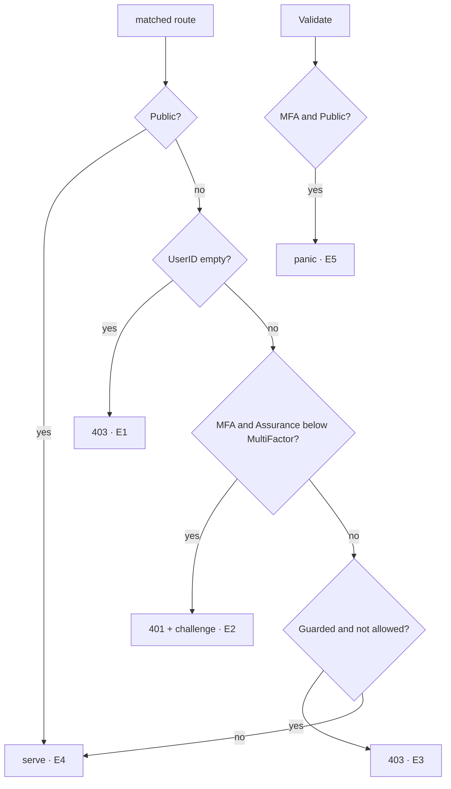

> This plan is dispatched via the CodeJob workflow. See skill: agents-workflow.

# Plan — edge: multi-factor routes

Master plan: `SECURITY_BY_DEFAULT_MASTER_PLAN.md` in the maintainer's
workspace (not published; everything you need is restated here).

## Why

`webtyp.com/router` (new tag) adds three things:
- `Route.RequiresMFA()`;
- `RouteInfo.MFA bool`;
- `Context.SetAssurance(model.Assurance)` / `Context.Assurance()`.

It also adds the constants `router.HeaderWWWAuthenticate`,
`router.ChallengeMFARequired` and `router.ErrMsgPublicRequiresMFA`, plus new
conformance clauses. `edge` implements `router.Router`, `router.Route` and
`router.Context`, so it must implement and enforce them.

Semantics (identical to `server/httpd`; the shared conformance suite checks
both):
1. Anonymous caller on a non-public route → **403**, as today.
2. Identified caller on a route with `MFA == true` and
   `ctx.Assurance() < model.AssuranceMultiFactor` → **401**,
   `WWW-Authenticate: <router.ChallengeMFARequired>`, body `"Unauthorized"`.
   The handler and middlewares do not run. Log it with
   `log.Reject(401, method, pathname, "single-factor caller on a route that requires MFA")`.
3. Then the permission check → 403 when denied, as today.
4. `edge.Validate` panics on a route with `MFA && Access == model.AccessPublic`:
   `panic("edge: route " + method + " " + path + " " + router.ErrMsgPublicRequiresMFA)`.

## Constraints (from AGENTS.md, restated)

- This is the **runtime** shipped inside every Worker (TinyGo, 1 MB cap). No
  tooling code, no `os/exec`, no `net/http`. No `map` in WASM code. Use
  `webtyp/fmt`, not `strings`/`strconv`/`errors`.
- Tests in `tests/`. Use `gotest`.

## Stage 1 — bump and implement (`edge/edge.go`)

1. `go get webtyp.com/router@latest webtyp.com/model@latest`. If
   `router.Route` has no `RequiresMFA`, **stop**.
2. `wasmContext`: field `assurance model.Assurance`; `SetAssurance` stores
   it; `Assurance()` returns `model.AssuranceNone` when `c.UserID() == ""`.
3. `wasmRoute.RequiresMFA()`: `r.info.MFA = true; return r`.
4. Replace `allows(info, userID) (bool, string)` with
   ```go
   // gate decides a request: 0 means serve; otherwise the status to answer
   // and the reason to log.
   func (r *wasmRouter) gate(info router.RouteInfo, ctx router.Context) (status int, why string)
   ```
   Order: Public → 0. `ctx.UserID() == ""` → 403 with the existing reasons.
   `info.MFA && ctx.Assurance() < model.AssuranceMultiFactor` → 401,
   `whySingleFactor`. Guarded and not allowed → 403 with the existing reason.
   Otherwise 0.
5. In the dispatch path (where `allows` is called today):
   ```go
   if status, why := r.gate(route.info, ctx); status != 0 {
       log.Reject(status, method, pathname, why)
       if status == 401 {
           ctx.SetHeader(router.HeaderWWWAuthenticate, router.ChallengeMFARequired)
       }
       ctx.WriteStatus(status)
       ctx.Write([]byte(bodyFor(status)))
       return
   }
   ```
   Constants: `bodyForbidden = "Forbidden"`, `bodyUnauthorized = "Unauthorized"`,
   `whySingleFactor = "single-factor caller on a route that requires MFA"`.
   `bodyFor` is a tiny unexported switch.
6. `Validate`: before the `Access != model.AccessGuarded` skip, add the MFA +
   Public panic above.

## Stage 2 — conformance driver (`tests/edge_conformance_test.go`)

`conformance.ServeFunc` now receives `who conformance.Identity` (`UserID`,
`Assurance`), and `conformance.Response` gained `Challenge string`.
- `conformanceCtx` implements `SetAssurance`/`Assurance` (same None-when-
  anonymous rule) and records response headers if it does not already.
- The driver sets `conformanceUserHeader` from `who.UserID` and a new
  `conformanceAssuranceHeader = "X-Conformance-Assurance"` from
  `fmt.Convert(uint8(who.Assurance)).String()`. The test `Authn` parses it
  back and calls `ctx.SetAssurance`.
- Fill `Response.Challenge` from the recorded `WWW-Authenticate` header.

## Branch diagram



| Branch | Test |
|---|---|
| E1–E5 | router conformance clauses `mfa_*` and `public_mfa_route_fails_at_startup`, run by `TestEdgeConformance` |
| None-when-anonymous | `tests/assurance_test.go`: Authn sets `MultiFactor` without a user id on `.Authenticated().RequiresMFA()` → 403 |

## Stages

| # | Files | Done when |
|---|---|---|
| 1 | `go.mod`, `go.sum`, `edge/edge.go` | compiles against the new router |
| 2 | `tests/edge_conformance_test.go`, `tests/assurance_test.go` | conformance green |
| 3 | `README.md` (edge access: one line on `RequiresMFA`) | docs match |

## Acceptance criteria

- `gotest` green (stdlib and WASM).
- `grep -rn "func (r \*wasmRouter) allows" edge/` → empty (replaced by `gate`).
- Before opening the PR: `git diff --stat main` lists every file of the
  stages table, and no file is deleted that this plan does not order deleted.
